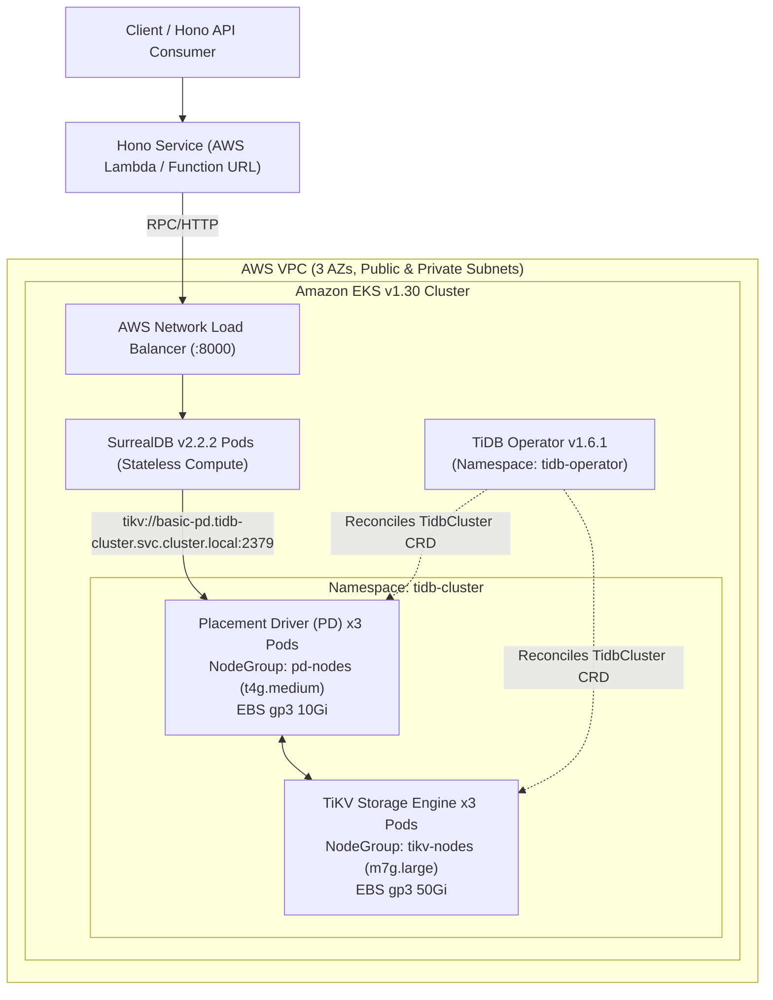

# SST / Pulumi Deployment Guide: SurrealDB on TiKV (AWS EKS)

## 1. Architecture Diagram



---

## 2. Step-by-Step Setup Instructions

### Prerequisites
- AWS Account with Administrator or EKS/EC2/IAM provisioning permissions
- AWS CLI v2 configured (`aws configure`)
- Node.js `>=20.11.0` and `pnpm` installed
- `kubectl` and `helm` installed locally for cluster verification

### Installation
```bash
git clone https://github.com/vanthienvt/sst-eks-surrealdb.git
cd sst-eks-surrealdb
pnpm install
```

---

## 3. Required Environment Variables

Create a `.env` file in the root directory:
```env
AWS_REGION=us-east-1
SURREALDB_URL=http://localhost:8000/rpc
SURREALDB_USER=root
SURREALDB_PASS=root
SURREALDB_NS=production
SURREALDB_DB=main
SURREALDB_AUTH=false
```

---

## 4. Deployment Process

1. **Deploy Infrastructure & Kubernetes Releases:**
   ```bash
   pnpm run deploy
   # Or: npx sst deploy --stage production
   ```
   This provisions:
   - Multi-AZ VPC (`SurrealDBVpc`)
   - EKS v1.30 Cluster (`SurrealDBCluster`) + `aws-ebs-csi-driver` addon + GP3 StorageClass
   - Dedicated tainted Managed NodeGroups for `pd` (`pd-nodes`) and `tikv` (`tikv-nodes`)
   - PingCAP `tidb-operator` (`v1.6.1`) + CRDs
   - `TidbCluster` (`basic` in namespace `tidb-cluster`) with 3 PD replicas and 3 TiKV replicas
   - `surrealdb` Helm chart (`v2.2.2`) connected to `tikv://basic-pd.tidb-cluster.svc.cluster.local:2379`
   - `HonoService` connected to the SurrealDB LoadBalancer endpoint

2. **Verify Pods on EKS:**
   ```bash
   kubectl get pods -n tidb-cluster
   kubectl get pods -n default -l app.kubernetes.io/name=surrealdb
   ```

---

## 5. Testing the Hono Service

Once deployed, test the Hono service URL output by `sst deploy`:

```bash
# 1. Health Check
curl -s https://<HONO_FUNCTION_URL>/health | jq .

# 2. Create a User Record in SurrealDB backed by TiKV
curl -s -X POST https://<HONO_FUNCTION_URL>/users \
  -H "Content-Type: application/json" \
  -d '{"name": "Alice", "role": "Engineer"}' | jq .

# 3. Query All Users from TiKV
curl -s https://<HONO_FUNCTION_URL>/users | jq .
```

---

## 6. Troubleshooting Guide

1. **PD / TiKV Pods Stuck in `Pending`:**
   - **Cause:** EBS PersistentVolumeClaims (`gp3`) waiting for `aws-ebs-csi-driver` IAM permissions or node group taints mismatch.
   - **Fix:** Ensure `AmazonEBSCSIDriverPolicy` is attached to `surrealdb-eks-node-role` (handled automatically in `surrealdb.ts`) and verify `kubectl get sc gp3`.
2. **SurrealDB CrashLoopBackOff on First Boot:**
   - **Cause:** SurrealDB starts before `basic-pd` service is ready on port `2379`.
   - **Fix:** Kubernetes automatically restarts the pod once `basic-pd.tidb-cluster.svc.cluster.local:2379` finishes raft leader election (~60 seconds).

---

## 7. Cleanup Instructions

To tear down all AWS resources (NLB, EKS NodeGroups, EBS Volumes, NAT Gateways, and VPC):
```bash
pnpm run remove
# Or: npx sst remove --stage production
```
